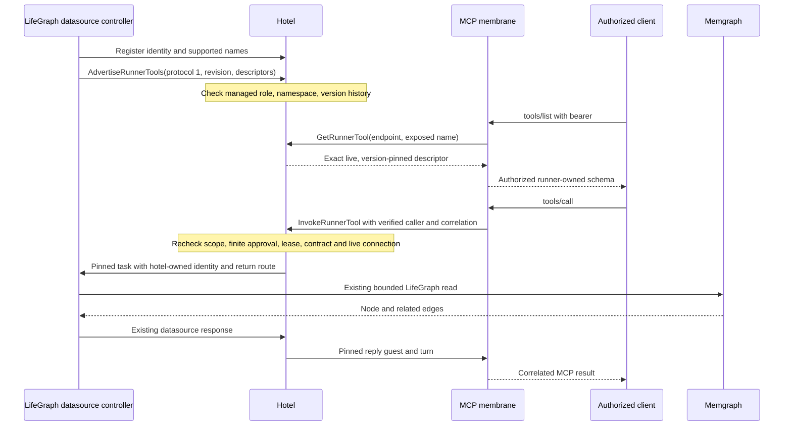

# Runner-owned native graph tools

## Goal

Give a native graph runner ownership of its executable tool definitions while
the hotel remains the supervisor, policy enforcer and router. MCP projects
only an explicitly authorized, currently available subset.

## Core Recommendation

The existing `LifeGraphProvider` owns `life.view.node@1`: exact canonical ID
recall with 1–200 related edges, default 50. It uses the existing Memgraph
queries and does not require embeddings or caller-supplied Cypher. The generic
graph datasource stays generic. No new runner process, gateway, issuer,
credentials, backend authority or graph lifecycle is introduced.



## Disposition

Accepted for the current local slice. Implementation and isolated real-component
composition are present; integration into `develop`, publication, production
deployment and intended-client acceptance are pending. This does not declare
the full semantic recall or external graph-read governance architecture complete.

## Current Slice

- `ansible-mesh-core/src/runner_tool.rs`: protocol/versioned descriptions,
  bounded flat argument schema and validation. Unsupported schema constraints
  fail closed; this is deliberately not a general JSON Schema implementation.
- `datasource/src/controller.rs`, `runtime.rs`: optional provider definitions;
  advertise through the existing connection before processing work. Factory,
  per-task provider selection, sequential writes, bounded concurrent reads,
  deadlines, emitter connection, replies and coordination guard are preserved.
- `data-memorygraphrag/src/lib.rs`, `provider.rs`: the executable node recall
  contract belongs to the LifeGraph provider. Old central catalog entries stay
  as transitional compatibility defaults, not authority for the native path.
- `aiua/src/service/ipc/runner_tools.rs`: managed LifeGraph guest enrollment,
  connection-owned publication, endpoint projection and deterministic routing.
  Persisted contract history fences same-version semantic changes and version
  downgrades across reconnects; it never stands in for live registration.
- Session assembly replaces schemas only on already-authorized, preselected
  local runner routes. Advertising cannot add tools or override a remote owner.
- `McpRouteTarget::RunnerTool` pins local guest, capability and tool version.
  `FieldMap` must have the exact tool action and no argument transformations.
  Provisioned schema/description placeholders are replaced at discovery and call
  time by the live runner definition. Legacy route-table mode refuses this target.
- External calls need an existing bearer grant with an exact exposed-tool scope,
  a finite preapproval bound to the exact action and target, a live membrane
  lease owned by its current connection, and an active runner enrollment.
  Calls recheck persisted endpoint policy and runner incarnation at admission.
  Caller arguments cannot supply identity, role, guest or return-route overrides.
- `membrane/src/runtime.rs`: invokes the hotel directly with endpoint, caller,
  version and correlation fields. The hotel creates the pinned datasource task;
  the existing return path resolves the waiting MCP call without a model turn.
- Integration exposed two lifecycle defects: listener tasks now stop with their
  owner, and MCP lease renewal now sends the granted epoch to `RenewMcpMembraneLease`.

### Compatibility and limits

The guest identity wire shape is unchanged. Providers without definitions still
register no tools. A new runner first asks `GetConfig(__runner_tool_protocol__)`;
an older hotel returning no feature retains the legacy datasource path and is
not sent the new advertisement. Older runners remain usable through their old
routes but cannot appear on a native descriptor-bound endpoint. Unknown target
variants fail closed on older hotels. The local old/new hotel/runner binary
matrix is qualified below; old membrane binaries remain outside that matrix.

This first increment is local-hotel and read-only. General structured schemas,
semantic `life.recall`, cross-hotel descriptor propagation, writes, dynamic
preapproval prompts and per-node tenancy policy are deferred. The endpoint
grant covers the selected capability on the canonical LifeGraph; it does not
invent a graph partition or row-level policy.

The hotel inherits the existing trusted local IPC registration boundary.
Caller/runner guest names are not new kernel-bound process attestations. The
membrane authenticates the bearer; the hotel trusts the leased membrane's
asserted verified caller and checks its persisted grant. This does not install
the protected-local authority adapters or claim resistance to a hostile process
already authorized to administer the legacy hotel socket. In-flight reads are
not cancelled/drained by grant revocation; revalidation applies at admission.
Existing required external-read coordination still refuses the underlying
unfenced LifeGraph provider. No production gate is disabled by this change.

## Verification and delivery record

Base: fetched `origin/develop` at `d4ecb35fc1064c8281b42cda61d7927ab0d0cc15`.
Worktree: `Documents/Codex/2026-11-05/task/native-graph-tools`, branch
`codex/native-graph-tools`. No other checkout was edited. Integrate the local
commit through the coordinating thread into `develop` after review; do not
merge to `main` or deploy as part of this work.

Real-component smoke passed:

```sh
cargo build -p aiua -p data-memorygraphrag --bin aiua --bin life-graph-runner
PHILOTIC_TEST_BIN_DIR="$PWD/target/debug" \
PHILOTIC_GRAPH_TOOL_MEMGRAPH_FIXTURE=1 \
cargo test -p membrane-mcp real_native_graph_runner_memgraph_mcp_composition \
  -- --ignored --nocapture
```

The test requires a disposable empty Memgraph at `127.0.0.1:17687`, checks
emptiness before inserting its single synthetic canary, and removes only that
canary on success. No production URI or environment credentials are inherited.
It uses fresh actual `aiua` and `life-graph-runner` subprocesses, the production
MCP runtime/server over HTTP, actual UDS, actual datasource lifecycle and real
Memgraph. Only identities, authorization policy, bearer/hash resolver and graph
content are synthetic; this is not production or intended-client verification.
It proves authorized recall, hidden discovery and denied calls for invalid or
unscoped callers, invalid input, disconnected runner, fresh runner registration,
hotel SQLite restart persistence and post-restart successful recall.

Four real-UDS hotel tests cover duplicate/idempotent/stale registration,
connection replacement, same-version semantic conflict across reconnects,
unsupported schema/protocol, forbidden namespace/write definitions, endpoint
identity, exact scope, stale version pins, disabled enrollment, lease loss,
argument/return-route forgery rejection, expired approval/lease deadlines and
preselected assembly projection.
Their provider response is explicitly synthetic. A framed-UDS membrane test
checks epoch renewal and lease-loss handling. Initial checkpoint `248e3605`
regression totals were
4 hotel UDS tests, 24 existing MCP contract tests, 4 datasource tests,
21 membrane tests, 43 MCP membrane tests (2 opt-in compositions ignored in the
general run), 228 LifeGraph library tests and 57 LifeGraph provider tests.
Together with the separately enabled full Memgraph composition, 382 checks
passed. `cargo check` for the affected components, affected-target Clippy and
`cargo fmt --all -- --check` passed. Clippy reports existing repository warnings;
this is not a warning-free workspace claim. The docs metadata command reports
existing missing files/frontmatter elsewhere; the new proposal's required keys
were checked independently. `git diff --check` passes.

CI wiring: `.github/workflows/lifegraph-capture-memgraph-acceptance.yml` runs
the native UDS tests and full Memgraph composition before other graph fixtures.
It builds existing binaries; no new package or deployment step is introduced.
The local change has not been pushed, so no exact-head remote CI result or
published artifact is claimed. Whole-workspace baseline validation was not run
under disk pressure; targeted regression and real-component checks are the
evidence for this slice.

Initial `248e3605` fixture artifacts (follow-up qualification is recorded below):

- `target/debug/aiua` SHA-256 `35dc27f94fd0883f810b264c9c99bcfa54123f985f71895419f3b7df12805e71`.
- `target/debug/life-graph-runner` SHA-256 `6c46d97a9efa74fedbca57c77dad20038214cbe8af5e348f66788247ae2f1f9b`.
- These are local build artifacts in the reused Cargo target, not installed
  production binaries. Fixture processes and task-owned Memgraph container are
  stopped. No effective production configuration, supervisor or deployment
  entrypoint changed. Production rollback is therefore not applicable.
- Production acceptance remains owned by the coordinating thread: review,
  `develop` integration, exact-head CI, then separately authorized deployment
  and client verification. No access, credentials or endpoint were created in
  an existing hotel.

## Disk and worktree inventory

The initial volume had approximately 17 GiB available. The existing main Cargo
target was 18 GiB; this work reused it with Cargo's build lock and disabled new
incremental output rather than creating another target directory. No existing
cache, worktree or Docker data was deleted. The cached Memgraph image was reused
with loopback binding and tmpfs graph/log directories.

Six older registered worktrees were clean with HEAD already ancestral to fetched
`origin/develop`: Apple readiness, LifeGraph synthetic diagnostic, Philote local
recovery, normal recovery, local work recovery and guidance repair. They are
candidates for owner-reviewed retirement, not automatic deletion. The main
`codex/beacon-civic-core` checkout has an unrelated modified Telegram file and
is not a retirement candidate. Large observed targets include LifeGraph 10 GiB,
Philote local recovery 14 GiB, and several older nonregistered native-memory
qualification directories (up to 28 GiB); those need a separate ownership and
retention check. This worktree should retire promptly after its reviewed commit
is integrated. Harness telemetry and graph mutation/writeback were not run;
Muninn readiness/recall and a read-only coordination dashboard check did run.
The closeout preference write to local Muninn was refused because that listener
is not the cluster Cortex; it is deferred. No redirect or retry to another node
was attempted.

## Review qualification and observable transactions

The review follow-up extends the same real Memgraph/HTTP/UDS composition with
typed `RevokeMcpTokenGrant` and `RevokeMcpEndpoint` operations. Each is followed
by hidden discovery and denied invocation, including deliberately stale
membrane endpoint snapshots. A successful read separates the two revocation
cases. The test also verifies that the revoked endpoint is absent from durable
hotel configuration.

The stale-grant case first failed against `248e3605`: invocation checked the
hotel's persisted caller grant, but descriptor lookup checked only endpoint
authority. This follow-up binds `GetRunnerTool` to the membrane's verified opaque
caller ID and rechecks exact scope and expiry against current hotel policy.
Missing caller IDs from the unbound prototype deserialize to empty and are
denied. No reusable bearer is sent to the hotel or runner. Current source tests
verify empty/unknown caller refusal and the missing-field wire shape.

`NativeToolObservation` emits an allowlisted `native_graph_transaction` log
projection for descriptor discovery and invocation admission: phase, operation
from a validated descriptor, policy outcome/code, admission duration, and stable
BLAKE3-derived references for endpoint, exposed tool, caller, session and turn.
It does not serialize the request, arguments, response, credentials, HTTP
headers, vault values or graph content. Hash references correlate opaque IDs
without copying arbitrary identity strings into this new telemetry. They are
linkable metadata, not anonymization or a credential store.

The full fixture asserts actual hotel transaction events contain timing and
correlation fields and both allowed/denied outcomes, while synthetic bearer,
argument-key, authorization-header and private graph-payload canaries are absent
from hotel/process/runner logs. A separate pure metadata test verifies the exact
field allowlist. Only synthetic payloads are inspected. Admission timing is not
end-to-end provider latency; no model token accounting is invented for this
deterministic graph read. The existing log writer/retention is reused, with no
new database, capture listener, model call or observability authority.

### Existing observability and memory hooks remain separate

Source inspection found `RouterTraceStorage` in
`ansible-mesh-core/src/router_trace.rs`: narrow provider/task/outcome/latency/token
records owned exclusively by model-router, node-local and not mesh-synced. This
slice does not write that training tap from the hotel. Existing hotel
`EventEnvelope`/`TaskInvoke` records carry work messages via `EventPayload::Inline`;
they are not a universal payload-redaction boundary. The new metadata events
are not a replacement for the durable message ledger or full transaction
completion tracing.

`philote/src/memory_integration.rs` still runs Muninn auto-recall and the separate
LifeGraph `life.recall` prefetch/cache/injection lane before prompt construction.
No Philote source or data was migrated or deleted. Current source already has a
`memory_degraded` prompt marker for some failed/degraded Muninn recalls, while
`session/mod.rs` omits an empty recalled-memory section when no marker exists.
LifeGraph prefetch failures/unusable packets can degrade to no injection. Native
tool exposure neither replaces these hooks nor supplies a completed no-match
status to reasoning.

Follow-on contract, owned by the coordinating architecture workstream:

- Extend existing recall/session/context projection with explicit outcomes for
  matched, completed-no-authorized-match, skipped, unavailable and failed recall;
  include source lane, freshness and permitted counts without exposing hidden
  records. Render successful no-match to reasoning rather than inferring it
  from absence or a log event.
- Carry candidate/proposed memory state and provenance through existing
  `RecalledMemoryRecord`/context packet paths. Preserve trust/source/confidence
  and distinguish suggestions from confirmed LifeGraph truth; do not silently
  promote, migrate or discard records.
- Test the automatic hooks through actual prompt construction for empty success,
  outage, stale cache and candidates, independently of native tool invocation.
- Qualify capture privacy before enabling it: current auto-recall logs query and
  concept text; opt-in model-router transcription fanout carries transcript and
  audio/blob URLs to router-listener. These existing paths were inspected but
  not changed, activated or claimed redacted. A common capture allowlist and
  synthetic leakage tests across those paths remain necessary.

### Local binary compatibility matrix

`real_native_graph_old_new_hotel_runner_binary_matrix` uses separately pinned
actual binaries and real Memgraph. Old means exact source
`d4ecb35fc1064c8281b42cda61d7927ab0d0cc15`; current means this candidate. No
installed runtime is used. All four cases passed locally:

| Hotel | Runner | Existing legacy node recall | Native descriptor and invocation |
|---|---|---|---|
| old | old | passes | unsupported native provisioning refused |
| old | current | passes, negotiated fallback | unsupported native provisioning refused |
| current | old | passes | unavailable/denied, no fabricated descriptor |
| current | current | passes | passes with pinned correlation |

The old-hotel cases first accept a legacy endpoint as a framing/provisioning
control, then refuse the unknown native target without persisting it. The
current-hotel cases verify descriptor and invocation availability separately.
Current MCP HTTP behavior is covered by the full composition. Old membrane
binaries, a full three-component matrix, production issuer/frontdoor behavior
and intended-client acceptance remain unqualified.

Reproduction after the existing full fixture has returned its disposable graph
to empty:

```sh
PHILOTIC_TEST_BIN_DIR=/absolute/pinned/current \
PHILOTIC_TEST_OLD_BIN_DIR=/absolute/pinned/d4ecb35f \
PHILOTIC_GRAPH_TOOL_MEMGRAPH_FIXTURE=1 \
cargo test --locked -p membrane-mcp \
  real_native_graph_old_new_hotel_runner_binary_matrix -- --ignored --nocapture
```

The existing CI workflow now checks out the exact PR head, pins current binaries,
builds/pins the exact old baseline, and runs the matrix. This is checked-in
wiring, not a remotely executed exact-head CI result; publication remains
with the coordinating thread. The follow-up local regression set comprises
5 hotel/metadata tests, 43 MCP tests and 57 SDK tests, plus the two explicitly
enabled real-component compositions. Earlier unchanged-library regression
results remain identified above rather than being presented as newly rerun.

### Shared-target qualification boundary

The Pro still has no discovered persistent shared-target/sccache configuration
or worktree target symlink. Qualification reused the existing main target with
command-local `CARGO_TARGET_DIR`; old/current binaries were pinned outside its
mutable top-level filenames. No existing cache, worktree, power or security
configuration was changed or removed, and the Air was not accessed.

Switching the temporary old source snapshot and current worktree through that
one target exposed a stale local crate: the current SDK was linked against an
`ansible-mesh-core` artifact missing `runner_tool`. Cargo's process lock did not
prevent this serial cross-source mismatch. Touching the owned current core entry
source forced its rebuild without deleting caches; subsequent policy and real
component tests passed. CI includes that bounded rebuild before matrix tests.
This is not a general shared-cache fix. Until source/feature/toolchain/profile
invalidation is qualified, serialize source switches and pin runtime artifacts;
do not assume a common target or symlink alone makes concurrent qualification
safe. No new persistent cache solution was introduced.
